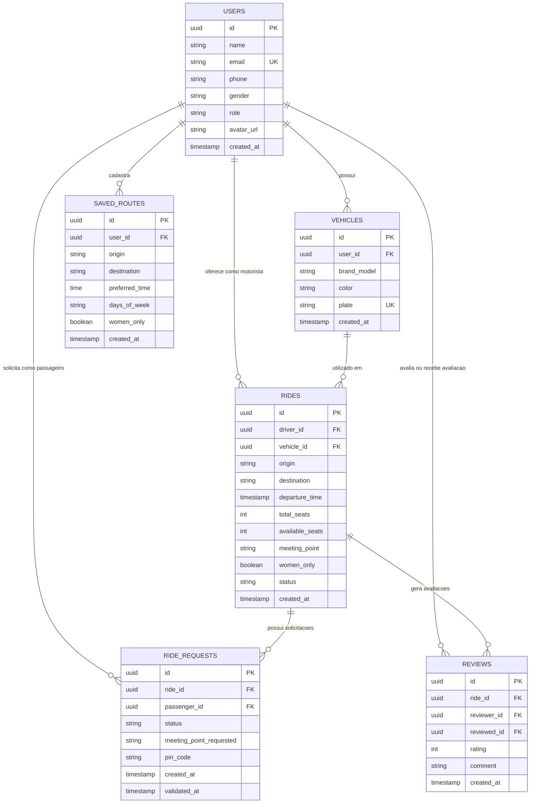

# 🛠️ Architecture / SSD

**Projeto:** PassAí — Caronas Universitárias UTFPR  
**Versão:** 1.0.0  
**Última atualização:** 2026-10-10  

> 🤖 **O `prd.md` responde _o quê_ o produto faz. Este responde _onde as coisas moram e como se chamam_.** Detalhe de tela — contrato específico de um formulário, máquina de estados interna de uma tela — **não** se decide aqui: isso é trabalho da spec de cada história.  
> (No texto oficial da disciplina este documento é o `ssd.md` — ID31.)  
> Decisões registradas e consolidadas através do workflow `/utf-architecture`.

---

## 🤖 1. Fontes de Contexto para a IA

> Onde a IDE agêntica busca a verdade. **Isto é o índice; a configuração mora nos arquivos** — documento não configura ferramenta.

| Fonte | Onde consultar / configurar | Serve para |
| :---- | :-------------------------- | :--------- |
| Constituição da IA | `.agents/rules/utf-rules.md` (via `AGENTS.md`) | Regras inegociáveis: fases do SDD, limite de 2 rodadas, revisores distintos, Gitflow |
| Fluxos da IA | `.agents/workflows/` | Workflows operacionais: `/utf-prd`, `/utf-design`, `/utf-architecture`, `/utf-setup`, `/utf-backlog`, `/utf-issue`, `/utf-task`, `/utf-tutor` |
| Agentes (subagentes) | `.agents/agents/` (cascas em `.claude/`, `.cursor/`, `.opencode/`) | Implementador, revisores de código e conformidade, auditor final e tutor |
| Ficha da disciplina | `docs/checklist.md` | Regras do projeto, Indicadores de Desempenho (IDs) e entregas |
| Tokens & PWA | `docs/design-tokens.md` | Paleta de cores, tipografia, breakpoints e identidade PWA (IDs 2, 3, 5) |
| Protótipo Stitch | [Protótipo no Stitch](https://stitch.google.com/preview/4331246840233990078?node-id=750e48e00d42490b9fc2ed021f95294b) | Telas, jornadas, componentes e hierarquia visual (ID1) |
| Servidores MCP | Context7, GitHub MCP, Supabase MCP | Contexto de documentação atualizada, automação de issues/PRs e BaaS (ID32) |

---

## 📦 2. Stack Tecnológica

> Definição **estrita**: nenhuma dependência entra sem aparecer aqui. Esta seção e o `package.json` contam a mesma história.

- **Frontend:** **Angular 20+** com detecção de mudanças **Zoneless** (`provideExperimentalZonelessChangeDetection()`).
- **Padrões de código obrigatórios da disciplina (IDs 4, 6, 7, 9, 10–15):**
  - **Standalone estrito (ID4):** Aplicação e componentes 100% standalone (sem NgModules). Não se declara `standalone: true` redundante no decorator.
  - **Fluxo de controle moderno (IDs 6, 7):** `@if` e `@switch` para renderização condicional; `@for` obrigatoriamente acompanhado de `track` único (ex.: `track item.id`).
  - **Deferrable Views (ID9):** Uso de `@defer (on viewport)` ou `@defer (on idle)` com blocos `@placeholder` e `@loading` para otimizar carregamento de listas e elementos pesados.
  - **Signals como fonte de verdade (IDs 10, 11, 12, 13):**
    - Todo estado reativo reside em Signals (`signal()`, `computed()`).
    - One-way binding via `{{ }}` e `[property]`.
    - Event binding via `(event)` disparando métodos que alteram Signals.
    - Two-way binding bidirecional exclusivamente via função moderna `model()`.
    - Efeitos colaterais restritos a `effect()` (ex.: sincronização com localStorage ou telemetria).
  - **Comunicação entre componentes (ID14):** Funções `input()` e `output()` tipadas para comunicação hierárquica pai-filho.
  - **Injeção de dependências (ID15):** Exclusivamente via função `inject()`, proibida injeção por construtor.
  - **Formatação declarativa (ID8):** Pipes nativos (`date`, `currency`) e pipes customizados (ex.: máscara de placa Mercosul/antiga, formato de telefone).
- **Framework CSS (ID5):** **Tailwind CSS** configurado para consumir os tokens semânticos definidos em `docs/design-tokens.md`.
- **Experiência PWA (ID3):** Configurado via `@angular/pwa` (`manifest.webmanifest`, ícones 192px/512px, tema `#4D389B`, display `standalone`, banner de fallback offline mantendo última carona/PIN visível).
- **Dados (em duas fases):**
  - **MVP (Entrega 2):** **json-server** com dados locais persistidos em `apps/api/db.json`.
  - **Entrega 3:** **Supabase** (PostgreSQL, Supabase Auth com JWT, CRUD via REST/SDK e Row Level Security - RLS) (IDs 21, 22).
- **Testes e Lint (ID33):**
  - Suíte de testes: Angular CLI test runner executando testes unitários em arquivos `.spec.ts` focados em regras de negócio e Services.
  - Linter: `angular-eslint` oficial integrado ao CLI.
  - Formatador: `prettier` e `eslint-config-prettier` na raiz do monorepo.
  - Comandos exatos:
    - Execução da suíte de testes: `npm run test -w apps/web` (ou `ng test --watch=false`)
    - Execução do linter: `npm run lint -w apps/web` (ou `ng lint`)
    - Formatação do código: `npm run format`

---

### 🌐 2.1. Camada de Dados — Regras Estruturais

- **Componente não fala com o servidor:** Todo acesso a dados e chamadas externas passam obrigatoriamente por **Services** em `core/services/` injetados via `inject()` (ID15). Nenhuma tela ou componente realiza chamadas HTTP ou interage diretamente com o SDK do banco.
- **Isolamento da troca de dados (E2 → E3):** A substituição do `HttpClient`/json-server pelo cliente Supabase é restrita e encapsulada nos arquivos de Service. A interface pública, métodos e Signals consumidos pelos componentes permanecem idênticos.
- **Autenticação e Sessão JWT (ID21):**
  - No MVP: `AuthService` simula sessão armazenando token fake e perfil de usuário no `localStorage`.
  - Na E3: `AuthService` conecta ao Supabase Auth, gerenciando JWT, refresh token e sessão persistida.
- **Interceptors Funcionais (ID23):**
  - `authInterceptor`: Interceptor funcional provido em `app.config.ts` que injeta o cabeçalho `Authorization: Bearer <token>` em todas as requisições autenticadas.
  - `errorInterceptor`: Interceptor funcional que captura respostas HTTP de erro (401, 403, 404, 500), padroniza notificações ao usuário e redireciona para login em caso de sessão expirada.
- **Integração com API Pública (ID20):** Service dedicado para consulta assíncrona GET à API pública do **ViaCEP** (`https://viacep.com.br/ws/{cep}/json/`) para preenchimento ágil de endereços e pontos de encontro.
- **Ponte Assíncrono ↔ Reativo (ID25):** Uso das funções `toSignal()` e `toObservable()` do `@angular/core/rxjs-interop` para converter fluxos RxJS em Signals consumíveis nos templates de forma limpa e síncrona.
- **Formulários Reativos (ID24):** Utilização estrita de `ReactiveFormsModule` e `NonNullableFormBuilder`, validações síncronas/assíncronas com mensagens de erro claras sob os inputs, e botão de submit desabilitado via `[disabled]="form.invalid"`.

---

## 🗂️ 3. Estrutura do Projeto

```text
.
├── .agents/                    # Constituição da IA, fluxos de trabalho e subagentes
├── AGENTS.md                   # Ponto de entrada das regras da IDE agêntica
├── README.md                   # Vitrine do projeto com checklist, links e diagrama ER
├── docs/                       # prd.md, architecture.md, design-tokens.md, checklist.md
├── specs/                      # Especificações funcionais e planos por história implementada
├── package.json                # Raiz do workspace (npm workspaces) com scripts unificados
└── apps/
    ├── web/                    # Aplicação Angular 20+ (SPA / PWA)
    │   ├── src/
    │   │   ├── app/
    │   │   │   ├── core/       # Singletons globais: services, guards, interceptors, models
    │   │   │   ├── shared/     # Componentes reutilizáveis, pipes, diretivas e layouts
    │   │   │   └── features/   # Domínios de negócio funcionais
    │   │   │       ├── auth/
    │   │   │       ├── rides/
    │   │   │       ├── vehicles/
    │   │   │       └── saved-routes/
    │   │   ├── environments/   # Configurações de ambiente (desenvolvimento / produção)
    │   │   └── manifest.webmanifest
    │   └── package.json
    └── api/                    # Reservada para backend futuro (no MVP guarda o db.json)
        ├── README.md           # Nota de reserva da pasta
        └── db.json             # Base de dados mock para json-server no MVP
```

---

### 📦 3.1. A Raiz do Monorepo (npm workspaces)

O `package.json` na raiz gerencia os subprojetos e provê os scripts orquestrados:

```json
{
  "name": "caronas-utfpr",
  "private": true,
  "workspaces": [
    "apps/*"
  ],
  "scripts": {
    "start": "npm run start -w apps/web",
    "build": "npm run build -w apps/web",
    "test": "npm run test -w apps/web",
    "lint": "npm run lint -w apps/web",
    "format": "prettier --write .",
    "api": "json-server --watch apps/api/db.json --port 3000"
  }
}
```

---

### 🧱 3.2. Organização Interna do App (`apps/web/src/app/` — Feature-Driven)

A organização segue a divisão em três camadas modulares:

1. **`core/`**: Serviços singleton de infraestrutura, autenticação e dados (`core/services/`), guards de rota funcionais (`core/guards/`), interceptors HTTP funcionais (`core/interceptors/`) e interfaces/tipos globais (`core/models/`).
2. **`shared/`**: Componentes de interface reutilizáveis (botões estilizados, campos de input, badges de status, modais genéricos), pipes customizados (formatação de placa, data/hora amigável) e layouts comuns.
3. **`features/`**: Módulos de domínio organizados por caso de uso (`auth`, `rides`, `vehicles`, `saved-routes`). Cada feature contém suas páginas e subcomponentes específicos.

**Regras estritas de dependência:**
- `features/` podem importar artefatos de `core/` e de `shared/`.
- `shared/` pode importar tipos de `core/models/`, mas **nunca** importa nada de `features/`.
- `core/` **não** importa nada de `shared/` nem de `features/`.
- **Uma feature NUNCA importa diretamente de outra feature.** A comunicação inter-domínios é realizada exclusivamente por parâmetros de rota na URL ou por serviços centrais em `core/services/`.

---

## 🧭 4. Roteamento e Navegação (SPA)

A navegação adota a API funcional moderna do Angular (IDs 16, 17, 18, 19):

- **Configuração:** `provideRouter` configurado em `app.config.ts` com a flag `withComponentInputBinding()`, permitindo que route params (`:id`) e query params (`?filtro=`) sejam vinculados diretamente a Signals `input()` nos componentes de página (IDs 16, 17).
- **Layouts e Rotas Filhas (ID18):** Estrutura de rotas aninhadas (`children: [...]`) utilizando layouts com componente casca (barra superior e barra de navegação inferior permanente para dispositivos móveis).
- **Functional Route Guards (ID19):**
  - `authGuard`: Bloqueia rotas protegidas para usuários não autenticados, redirecionando para `/login`.
  - `guestGuard`: Impede que usuários já autenticados acessem telas de login ou cadastro, redirecionando para `/home`.
  - `driverGuard`: Garante que apenas usuários com ao menos um veículo cadastrado e ativo publiquem ofertas de carona.
- **Lazy Loading:** Todas as rotas de features utilizam `loadComponent: () => import(...)` ou `loadChildren: () => import(...)` para carregar o bundle sob demanda.

---

## 🗄️ 5. Arquitetura de Dados (BaaS)

### 📖 5.1. Glossário Técnico (Mapeamento PT-BR → EN)

> Dados, código e banco de dados **estritamente em inglês**. Interface visual e mensagens ao usuário **em português**.

| Termo PRD (PT-BR) | Entidade / Tabela (EN) | Atributos Principais |
| :---------------- | :--------------------- | :------------------- |
| **Usuário** (Motorista / Passageiro) | `users` | `id` (PK, uuid), `name`, `email` (UK), `phone`, `gender` ('female' \| 'male' \| 'other'), `avatar_url`, `role` ('passenger' \| 'driver' \| 'admin'), `created_at` |
| **Veículo** | `vehicles` | `id` (PK, uuid), `user_id` (FK), `brand_model`, `color`, `plate` (UK), `created_at` |
| **Rota Salva** | `saved_routes` | `id` (PK, uuid), `user_id` (FK), `origin`, `destination`, `preferred_time`, `days_of_week` (string[]), `women_only` (boolean), `created_at` |
| **Carona (Viagem)** | `rides` | `id` (PK, uuid), `driver_id` (FK), `vehicle_id` (FK), `origin`, `destination`, `departure_time`, `total_seats`, `available_seats`, `meeting_point`, `women_only` (boolean), `status` ('open' \| 'in_progress' \| 'completed' \| 'cancelled'), `created_at` |
| **Solicitação de Carona** | `ride_requests` | `id` (PK, uuid), `ride_id` (FK), `passenger_id` (FK), `status` ('pending' \| 'accepted' \| 'rejected' \| 'cancelled'), `meeting_point_requested`, `pin_code` (char 4), `created_at`, `validated_at` |
| **Avaliação** | `reviews` | `id` (PK, uuid), `ride_id` (FK), `reviewer_id` (FK), `reviewed_id` (FK), `rating` (int 1-5), `comment`, `created_at` |

---

### 📊 5.2. Diagrama ER (Mermaid)

> Este diagrama representa o modelo relacional normalizado do banco de dados (BaaS/PostgreSQL e espelhado no `db.json`). Este mesmo bloco é renderizado no `README.md` como exige a ficha da disciplina.



---

### 🔒 5.3. Segredos e Ambientes

> Chaves do BaaS: a *anon key* do Supabase é pública por design e vive nos arquivos de ambiente do frontend (`environment.ts`). A integridade e segurança dos dados são garantidas por regras de **Row Level Security (RLS)** no banco de dados.  
> **Chaves mestras ou service role keys NUNCA são expostas ou comitadas no repositório.**

| Fase | Aplicação roda em | Fonte de dados | Configuração de URL / Chave |
| :--- | :----------------- | :------------- | :-------------------------- |
| **Local (E2 / MVP)** | `ng serve` (localhost:4200) | json-server (`apps/api/db.json` na porta 3000) | `apiUrl: 'http://localhost:3000'` em `environment.development.ts` |
| **Local (E3)** | `ng serve` (localhost:4200) | Supabase (Projeto Dev / Local) | `supabaseUrl` + `supabaseAnonKey` em `environment.development.ts` |
| **Produção (E3)** | Vercel ou Render (HTTPS) | Supabase (Projeto Cloud Produção) | `supabaseUrl` + `supabaseAnonKey` injetados no build em `environment.ts` |

---

## 🗺️ 6. Mapa de Domínios e Rotas

> Índice inicial alinhado ao PRD. Novas rotas são consolidadas aqui à medida que as User Stories são especificadas e implementadas.

| Domínio | Rota | Guard | Dados (Service) | US Correspondente |
| :------ | :--- | :---- | :-------------- | :---------------- |
| `auth` | `/login` | `guestGuard` | `AuthService` | US01 |
| `auth` | `/register` | `guestGuard` | `AuthService` | US01 |
| `rides` | `/home` (busca e feed de caronas) | `authGuard` | `RideService` | US03, US04 |
| `rides` | `/rides/new` (ofertar carona) | `authGuard`, `driverGuard` | `RideService` | US03 |
| `rides` | `/rides/:id` (detalhes da carona) | `authGuard` | `RideService`, `RideRequestService` | US04, US05 |
| `vehicles` | `/vehicles` (gestão de veículos) | `authGuard` | `VehicleService` | US02 |
| `saved-routes` | `/saved-routes` (rotas favoritas) | `authGuard` | `SavedRouteService` | US06 |
| `profile` | `/profile` (dados do usuário) | `authGuard` | `UserService` | US01 |

---

## 📅 7. Histórico

| Data | Versão | O que mudou |
| :--- | :----- | :---------- |
| 2026-10-10 | 1.0.0 | Versão inicial gerada via `/utf-architecture` cobrindo stack Angular 20+, Zoneless, Tailwind CSS, json-server / Supabase, modelos ER em Mermaid, testes e mapa de rotas. |

---

## 🛑 O que ainda **não** está neste documento

Detalhes específicos de implementação de telas (contratos de formulários, estados temporários de componentes, animações visuais particulares) **não pertencem a este documento**: nascem sob demanda no `spec.md` e `plan.md` de cada história no ciclo `/utf-issue`. Este documento estabelece exclusivamente os contratos, limites e convenções que governam o projeto como um todo.
